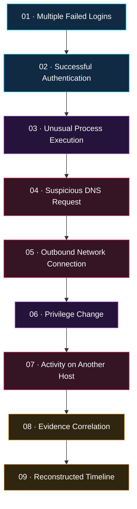
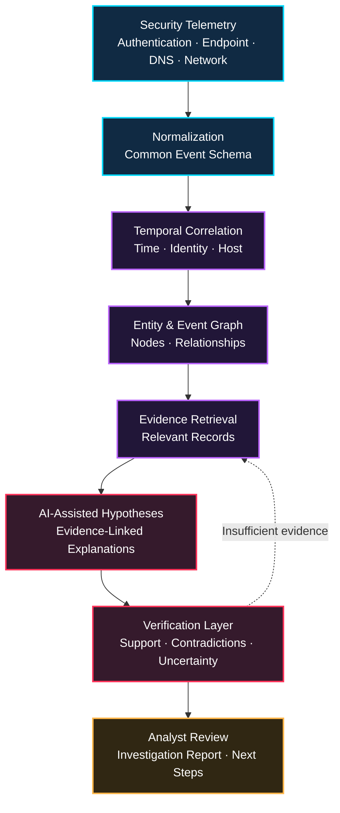
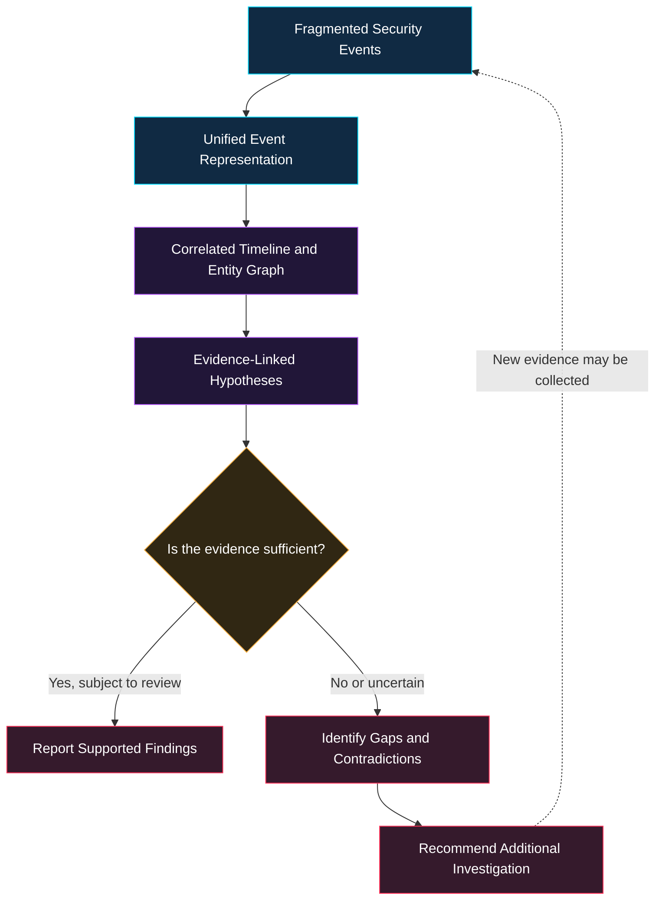

<div align="center">


### EVIDENCE-GROUNDED AI · DIGITAL FORENSICS · AUTONOMOUS INVESTIGATION

<p>
  
  
  
  
</p>

<h3>
  <code>DETECT</code> &nbsp; ◈ &nbsp;
  <code>CORRELATE</code> &nbsp; ◈ &nbsp;
  <code>RECONSTRUCT</code> &nbsp; ◈ &nbsp;
  <code>INVESTIGATE</code>
</h3>

<p>
  <strong>Every event leaves a trace. Every hypothesis needs evidence.</strong>
</p>

<p>
  An intelligent investigation framework that transforms fragmented
  security telemetry into explainable, evidence-linked incident narratives.
</p>

<br/>

<a href="#sentinel-x-visual-core">VISUAL CORE</a>
&nbsp; ◆ &nbsp;
<a href="#how-sentinel-x-works">HOW IT WORKS</a>
&nbsp; ◆ &nbsp;
<a href="#research-core">RESEARCH CORE</a>
&nbsp; ◆ &nbsp;
<a href="#project-roadmap">ROADMAP</a>

</div>


---

<a id="sentinel-x-visual-core"></a>

<div align="center">

## ◈ SENTINEL-X // VISUAL CORE

**A DIGITAL INVESTIGATION ENGINE**


<p>
  
  
  
  
</p>

</div>

---


<div align="center">


</div>


⫘⫘⫘⫘⫘⫘⫘⫘⫘⫘⫘⫘⫘⫘⫘⫘⫘⫘⫘⫘⫘⫘⫘⫘⫘⫘⫘⫘⫘⫘⫘⫘⫘⫘⫘⫘
⫘⫘⫘⫘⫘⫘⫘⫘⫘⫘⫘⫘⫘⫘⫘⫘⫘⫘⫘⫘⫘⫘⫘⫘⫘⫘⫘⫘⫘⫘⫘⫘⫘⫘⫘⫘⫘⫘⫘


SENTINEL-X is designed as a complete Master's graduation project combining software engineering, defensive cybersecurity, artificial intelligence, data analysis, graph-based reasoning, and scientific experimentation.

The objective is not simply to create an attractive cybersecurity dashboard. It is to develop a working system that accepts security logs, identifies relationships between events, reconstructs possible incident timelines, links conclusions to supporting evidence, maps observed behaviors to MITRE ATT&CK, and assists a human analyst in investigating suspicious activity.

This document provides the project from A to Z in English, including the academic report, problem statement, objectives, research contribution, system architecture, block diagram, flowcharts, algorithms, data models, implementation code, testing strategy, advantages, limitations, development roadmap, and final-defense preparation.

An important academic distinction: the architecture and code below form a foundation for a research prototype. Any claims about accuracy, performance, completed implementation, or experimental results must be verified by actually implementing and testing the system. We will not invent results or claim that features have been implemented before they exist.


⫘⫘⫘⫘⫘⫘⫘⫘⫘⫘⫘⫘⫘⫘⫘⫘⫘⫘⫘⫘⫘⫘⫘⫘⫘⫘⫘⫘⫘⫘⫘⫘⫘⫘⫘⫘⫘⫘⫘⫘⫘⫘⫘⫘⫘⫘⫘⫘⫘⫘⫘⫘⫘⫘⫘⫘⫘⫘⫘⫘⫘⫘⫘⫘⫘⫘⫘⫘⫘⫘⫘⫘⫘⫘⫘⫘⫘⫘


⫘⫘⫘⫘⫘⫘⫘⫘⫘⫘⫘⫘⫘⫘⫘⫘⫘⫘⫘⫘⫘⫘⫘⫘⫘⫘⫘⫘⫘⫘⫘⫘⫘⫘⫘⫘⫘⫘⫘⫘⫘⫘⫘⫘⫘⫘⫘⫘⫘⫘⫘⫘⫘⫘⫘⫘⫘⫘⫘⫘⫘⫘⫘⫘⫘⫘⫘⫘⫘⫘⫘⫘⫘⫘⫘⫘⫘⫘


⫘⫘⫘⫘⫘⫘⫘⫘⫘⫘⫘⫘⫘⫘⫘⫘⫘⫘⫘⫘⫘⫘⫘⫘⫘⫘⫘⫘⫘⫘⫘⫘⫘⫘⫘⫘⫘⫘⫘⫘⫘⫘⫘⫘⫘⫘⫘⫘⫘⫘⫘⫘⫘⫘⫘⫘⫘⫘⫘⫘⫘⫘⫘⫘⫘⫘⫘⫘⫘⫘⫘⫘⫘⫘⫘⫘⫘⫘


---

<a id="project-description"></a>

<div align="center">


# <span style="color:#00D9FF">01 // PROJECT DESCRIPTION</span>

<sub>UNDERSTANDING THE MISSION · DEFINING THE SYSTEM</sub>

</div>

> [!IMPORTANT]
> **SENTINEL-X** is an AI-assisted cybersecurity incident investigation platform designed to correlate security events, reconstruct incident timelines, and produce explainable, evidence-linked investigative hypotheses.

## <span style="color:#BB63FF">⌬ The Core Idea</span>

SENTINEL-X processes **heterogeneous security telemetry** and transforms fragmented digital observations into a structured investigation.

Security telemetry includes records generated by:

<div align="center">

| <span style="color:#00D9FF">01 · SYSTEMS</span> | <span style="color:#BB63FF">02 · IDENTITY</span> | <span style="color:#FF3158">03 · NETWORK</span> |
|:---:|:---:|:---:|
| Operating systems | Authentication services | Firewalls |
| Endpoint protection | Identity providers | DNS resolvers |
| Applications | Account activity | Network monitoring |

</div>

In a typical organization, these sources generate large volumes of events. Some are harmless, while others may indicate suspicious activity. The challenge is that one incident can span multiple systems and time periods.

## <span style="color:#FF3158">⌁ A Multi-Stage Incident Scenario</span>

The following sequence illustrates a **hypothetical investigation scenario**, not a claim that an attack has been detected.



Analyzing each event independently may fail to reveal the overall sequence. SENTINEL-X aims to correlate events, construct chronological timelines, identify relationships between users, hosts, processes, and network indicators, and generate hypotheses linked to supporting evidence.

## <span style="color:#00D9FF">◈ The Investigation Principle</span>

<div align="center">

| <span style="color:#00D9FF">OBSERVED FACT</span> | <span style="color:#BB63FF">INFERRED HYPOTHESIS</span> | <span style="color:#FFB547">VERIFIED CONCLUSION</span> |
|:---|:---|:---|
| A recorded event with a traceable source | A possible explanation of several events | A conclusion assessed against available evidence |

</div>

The system treats AI as an investigation assistant, not an unquestionable authority. Conclusions must remain traceable to available evidence, uncertainty must be preserved, and consequential decisions must remain under human control.

---


<a id="executive-summary"></a>

<div align="center">


# <span style="color:#BB63FF">02 // EXECUTIVE SUMMARY</span>

<sub>THE RESEARCH VISION · THE ENGINEERING MISSION</sub>

</div>

## SENTINEL-X: An Evidence-Grounded Agentic Framework for Temporal Reconstruction and Investigation of Multi-Stage Cybersecurity Incidents

Modern organizations depend on interconnected digital infrastructure, including endpoints, servers, cloud services, applications, identity providers, and communication networks. These environments generate large quantities of security telemetry that must be analyzed to identify suspicious behavior and investigate potential cyber incidents.

Traditional security monitoring tools can generate alerts using predefined rules, signatures, statistical anomalies, and other detection mechanisms. However, investigating a complex incident often requires an analyst to correlate evidence from multiple sources, reconstruct event sequences, examine relationships between entities, distinguish malicious activity from legitimate behavior, and document the reasoning behind a conclusion.

SENTINEL-X proposes an AI-assisted investigation framework that combines six complementary capabilities:

<div align="center">

| Capability | Role in SENTINEL-X |
|:---|:---|
| <span style="color:#00D9FF">Event normalization</span> | Converts heterogeneous records into a common representation |
| <span style="color:#BB63FF">Temporal correlation</span> | Identifies candidate relationships between events |
| <span style="color:#FFB547">Graph representation</span> | Models relationships between entities and observations |
| <span style="color:#00D9FF">Retrieval-augmented generation</span> | Supplies relevant evidence to the AI investigation component |
| <span style="color:#FF3158">Evidence verification</span> | Checks references, contradictions, and unsupported claims |
| <span style="color:#BB63FF">Investigation planning</span> | Recommends additional evidence to examine |

</div>

Incoming security events are transformed into a common data representation and stored for analysis. A correlation engine identifies candidate relationships using timestamps, entities, event types, and configurable rules. A temporal graph represents relationships among users, hosts, processes, accounts, domains, IP addresses, and observed events.

The AI investigation component can retrieve relevant evidence, formulate hypotheses, identify contradictory observations, and recommend additional evidence that may help resolve uncertainty.

Each hypothesis is designed to include supporting evidence identifiers, contradictory evidence where available, missing evidence, and an explicit investigation status. MITRE ATT&CK can provide a structured reference for mapping observed behavior to known adversary tactics and techniques; a technique match is not, by itself, proof of an attack.

### <span style="color:#FFB547">Experimental Evaluation</span>

The proposed framework will be evaluated using controlled incident scenarios and suitable public datasets. Candidate metrics include:

- Event-correlation precision and recall.
- Timeline reconstruction accuracy.
- MITRE ATT&CK mapping performance.
- Evidence-grounding rate.
- Unsupported-claim rate.
- Processing latency and computational cost.

Baseline systems will be compared with retrieval-enhanced and graph-assisted investigation approaches to determine which components provide measurable benefits.

### <span style="color:#00D9FF">Expected Outcome</span>

The expected outcome is a reproducible research prototype and an experimental framework for studying explainable AI-assisted incident investigation. The platform is intended to support qualified security analysts, not replace them. Reliability, operational limitations, and security risks will be assessed through systematic testing.

<div align="center">


</div>

**Keywords:** Cybersecurity · Incident Response · Digital Forensics · Artificial Intelligence · Large Language Models · Retrieval-Augmented Generation · Event Correlation · Temporal Graphs · MITRE ATT&CK · Explainable AI.

---


<a id="project-objectives"></a>

<div align="center">


# <span style="color:#FFB547">03 // PROJECT OBJECTIVES</span>

<sub>FROM CONCEPT TO IMPLEMENTATION · FROM IMPLEMENTATION TO EVALUATION</sub>

</div>

### <span style="color:#00D9FF">▸ Primary Objective</span>

Design, implement, and evaluate an evidence-grounded framework for reconstructing multi-stage cybersecurity incidents.

### <span style="color:#BB63FF">▸ Specific Objectives</span>

- [ ] **Data Ingestion:** Collect security events from structured files and supported log sources.
- [ ] **Normalization:** Transform heterogeneous records into a common schema.
- [ ] **Temporal Correlation:** Correlate events using time, identity, host, process, and network information.
- [ ] **Timeline Reconstruction:** Organize potentially related events chronologically.
- [ ] **Graph Modeling:** Represent relevant entities and relationships as a graph.
- [ ] **ATT&CK Integration:** Map observed behavior to relevant MITRE ATT&CK techniques where supported.
- [ ] **RAG Integration:** Retrieve relevant evidence to inform AI-generated analysis.
- [ ] **Evidence-Grounded Hypotheses:** Link investigative claims to supporting and contradictory records.
- [ ] **Missing-Evidence Analysis:** Identify information gaps and recommend next investigative steps.
- [ ] **Report Generation:** Produce structured investigation reports.
- [ ] **Platform Security:** Implement authentication, authorization, input validation, and audit logging.
- [ ] **Scientific Evaluation:** Compare the system with baselines using reproducible experiments.

> [!NOTE]
> The checklist describes the intended development scope. Items should be marked complete only after implementation and testing.

---


<a id="what-makes-sentinel-x-interesting"></a>

<div align="center">


# <span style="color:#FF3158">04 // WHAT MAKES SENTINEL-X INTERESTING?</span>

<sub>THE CONVERGENCE OF AI · GRAPH ANALYSIS · DIGITAL FORENSICS</sub>

</div>

SENTINEL-X brings several technical disciplines together in one research-oriented engineering system.

### <span style="color:#00D9FF">01 — Artificial Intelligence</span>

Uses a large language model to help explain event sequences and formulate investigation hypotheses. Generated explanations must be checked against retrieved records rather than accepted automatically.

### <span style="color:#BB63FF">02 — Graph-Based Analysis</span>

Represents relationships among events, hosts, users, processes, and network entities, making multi-stage activity easier to explore.

### <span style="color:#FFB547">03 — Temporal Reconstruction</span>

Organizes observations chronologically and identifies plausible relationships across time while preserving uncertainty when event ordering or causality cannot be established.

### <span style="color:#FF3158">04 — Evidence-Grounded Reasoning</span>

Requires investigative claims to reference available records and distinguishes directly observed facts from inferred explanations.

### <span style="color:#00D9FF">05 — Scientific Evaluation</span>

Tests whether graph-based correlation, retrieval, and evidence verification improve investigation quality compared with simpler baselines.

<div align="center">


**SENTINEL-X · INVESTIGATE WITH EVIDENCE. REASON WITH TRANSPARENCY.**

<sub>MASTER'S GRADUATION PROJECT · RESEARCH AND ENGINEERING PROTOTYPE</sub>

</div>


<!-- ═══════════════════════════════════════════════════════════════ -->
<!-- SENTINEL-X | PART II — INTRODUCTION AND RESEARCH FOUNDATION    -->
<!-- ═══════════════════════════════════════════════════════════════ -->

<div align="center">

# <span style="color:#00D9FF;">◈ PART II</span>
# <span style="color:#BB63FF;">INTRODUCTION & RESEARCH FOUNDATION</span>

**<span style="color:#FFB547;">From Raw Security Telemetry to Evidence-Grounded Investigation</span>**

<br>


<br><br>

*Establishing the scientific foundations, research problem, and evaluation-driven contribution of SENTINEL-X.*

</div>

---

<div align="center">

`01 — INTRODUCTION` &nbsp; ◆ &nbsp; `02 — FOUNDATIONS` &nbsp; ◆ &nbsp; `03 — PROBLEM` &nbsp; ◆ &nbsp; `04 — RESEARCH GAP`

</div>

---

## <span style="color:#00D9FF;">╭─ 05. INTRODUCTION</span>

### <span style="color:#BB63FF;">05.1 — The Modern Cybersecurity Challenge</span>

Cybersecurity has become a fundamental requirement for modern digital infrastructure. Organizations rely on information systems to manage sensitive information, provide essential services, conduct financial transactions, and support industrial operations. As these environments grow in size and complexity, their exposure to cyber threats also increases.

Security incidents rarely produce only one observable signal. An incident may generate authentication records, endpoint events, network connections, DNS queries, process executions, account modifications, and application logs. These observations may be distributed across different systems, collected in different formats, and recorded with varying levels of detail.

Security analysts must examine these records to determine whether they represent a genuine incident, identify the affected entities, establish a plausible event sequence, assess the impact, and recommend appropriate defensive actions.

### <span style="color:#BB63FF;">05.2 — Why Investigation Remains Difficult</span>

The investigation process can be time-consuming. Incomplete telemetry may prevent a definitive conclusion, while unrelated benign activities may appear connected. Large language models can assist with summarization and reasoning, but they may also produce unsupported explanations, misinterpret logs, or express unjustified confidence.

An effective AI-assisted investigation system must therefore combine the flexibility of language models with structured data processing, deterministic validation, traceable evidence, and human oversight.

### <span style="color:#BB63FF;">05.3 — The SENTINEL-X Approach</span>

SENTINEL-X is proposed as a research framework for addressing this challenge. It integrates conventional event processing with graph-based relationships and retrieval-augmented AI reasoning.

> [!IMPORTANT]
> **Core principle:** A convincing explanation is not necessarily a correct explanation. Important conclusions must be supported by identifiable observations and evaluated against contradictory evidence.

The project pursues two complementary goals:

| Dimension | Primary objective |
|:--|:--|
| <span style="color:#00D9FF;">**Engineering**</span> | Build a modular, secure, usable incident-investigation platform. |
| <span style="color:#BB63FF;">**Research**</span> | Measure whether explicit evidence tracking, temporal correlation, graph representations, and verification improve AI-assisted incident reconstruction. |

### <span style="color:#FFB547;">05.4 — Conceptual Investigation Pipeline</span>



<sub><span style="color:#FFB547;">Research note:</span> This diagram represents the proposed architecture. It does not imply that every component has already been implemented or experimentally validated.</sub>

---

## <span style="color:#BB63FF;">╭─ 06. BACKGROUND & FUNDAMENTAL CONCEPTS</span>

### <span style="color:#00D9FF;">06.1 — Cybersecurity Incident</span>

A cybersecurity incident is an event or sequence of events that threatens or compromises the confidentiality, integrity, or availability of information or information systems.

Examples include unauthorized access, malicious software execution, account compromise, data exfiltration, and disruptive activity.

<blockquote>
  <span style="color:#FFB547;">⚠ Critical distinction:</span> A suspicious event is not automatically a confirmed incident. SENTINEL-X must preserve the distinction between observed activity, an investigative hypothesis, and a verified conclusion.
</blockquote>

### <span style="color:#00D9FF;">06.2 — Security Operations Center (SOC)</span>

A Security Operations Center (SOC) is a function or team responsible for monitoring, detecting, investigating, and coordinating responses to security threats.

SENTINEL-X is intended to support SOC analysts by organizing evidence and helping investigate alerts. It is not intended to replace a complete SOC or all its operational responsibilities.

### <span style="color:#00D9FF;">06.3 — Security Information and Event Management (SIEM)</span>

Security Information and Event Management (SIEM) platforms aggregate security logs, correlate activity, and provide detection and monitoring capabilities.

SENTINEL-X can complement a SIEM by accepting exported events or alerts and performing focused incident reconstruction. It does not need to replace the existing detection infrastructure.

### <span style="color:#00D9FF;">06.4 — Digital Forensics</span>

Digital forensics involves the systematic collection, preservation, examination, and interpretation of digital evidence.

For SENTINEL-X, this motivates the following design principles:

- [ ] Preserve original event records.
- [ ] Record source identifiers and timestamps.
- [ ] Keep transformations traceable.
- [ ] Record the origin of generated conclusions.
- [ ] Distinguish direct observations from analytical inferences.
- [ ] Preserve contradictory observations instead of silently discarding them.

> [!WARNING]
> A research prototype that analyzes logs is not automatically a certified forensic acquisition system. Chain-of-custody requirements and forensic integrity controls must be designed and tested if the system is intended for evidentiary use.

### <span style="color:#00D9FF;">06.5 — Large Language Models (LLMs)</span>

A large language model can interpret text, summarize information, classify descriptions, and generate structured explanations.

Within SENTINEL-X, the LLM is intended to generate candidate hypotheses and explain evidence. It should not independently determine that a cyberattack definitely occurred.

**Proposed responsibility boundary:**

| Component | Responsibility |
|:--|:--|
| Event-processing layer | Parse, normalize, and validate telemetry. |
| Correlation engine | Identify candidate relationships between events. |
| Retrieval layer | Retrieve relevant records from the available evidence collection. |
| Language model | Generate candidate explanations and investigative hypotheses. |
| Verification layer | Check evidence references and flag unsupported or contradictory claims. |
| Human analyst | Review the evidence and make operational decisions. |

### <span style="color:#00D9FF;">06.6 — Retrieval-Augmented Generation (RAG)</span>

Retrieval-Augmented Generation combines information retrieval with language generation.

Instead of asking a model to answer solely from its internal parameters, the system retrieves relevant records from an available evidence collection and supplies them as context. The model can then generate an explanation referencing those records.

```text
┌──────────────────────┐
│  Original Log Events  │
└──────────┬───────────┘
           ▼
┌──────────────────────┐
│ Evidence Preparation │
└──────────┬───────────┘
           ▼
┌──────────────────────┐
│ Relevant Retrieval   │
└──────────┬───────────┘
           ▼
┌──────────────────────┐
│ LLM-Assisted Analysis│
└──────────┬───────────┘
           ▼
┌──────────────────────┐
│ Evidence Verification│
└──────────────────────┘
```

**Important limitation:** RAG improves access to relevant information but does not guarantee factual correctness. Retrieved evidence can be incomplete, irrelevant, outdated, or incorrectly interpreted.

### <span style="color:#00D9FF;">06.7 — Graph-Based Reasoning</span>

A graph represents entities as nodes and relationships as edges. This representation can help analysts explore connections between accounts, hosts, processes, domains, IP addresses, and observed activities.

**Illustrative relationship model:**


The relationships shown above are illustrative. In a real investigation, each edge should retain its supporting event references, timestamps, and relationship confidence where applicable. A possible relationship must not be presented as a proven causal link.

### <span style="color:#00D9FF;">06.8 — MITRE ATT&CK</span>

MITRE ATT&CK is a knowledge base of adversary tactics and techniques based on observed attack behavior. SENTINEL-X can use the Enterprise knowledge base to organize behavioral observations into recognizable categories.

ATT&CK mappings can help analysts describe suspected behaviors consistently, communicate investigative findings, and identify potentially relevant evidence.

> [!NOTE]
> **A technique mapping is not proof of an attack.** It is an analytical classification whose validity depends on the available evidence and the quality of the interpretation.

---

## <span style="color:#FF3158;">╭─ 07. PROBLEM STATEMENT</span>

### <span style="color:#BB63FF;">07.1 — The Core Problem</span>

Organizations collect security telemetry from multiple sources, but the events associated with one incident may be fragmented across systems and time. Analysts must manually correlate these observations, construct timelines, examine relationships, and justify their conclusions.

Traditional rules can identify known patterns but may struggle with unfamiliar combinations of events or incomplete contextual information. Language models can summarize events but may generate explanations that are not supported by the underlying records.

The central problem addressed by SENTINEL-X is therefore:

> **How can heterogeneous security events be transformed into a temporal, evidence-linked incident representation that supports AI-assisted investigation while preserving traceability, uncertainty, and human control?**

### <span style="color:#BB63FF;">07.2 — Five Dimensions of the Problem</span>

| ID | Challenge | Description | Research direction |
|:--:|:--|:--|:--|
| <span style="color:#00D9FF;">P1</span> | **Data heterogeneity** | Different sources use different schemas and terminology. | Event normalization |
| <span style="color:#BB63FF;">P2</span> | **Temporal complexity** | Related activities occur at different times and across multiple hosts. | Timeline reconstruction |
| <span style="color:#FFB547;">P3</span> | **Relationship discovery** | Entities and events must be connected without unjustified associations. | Graph-based correlation |
| <span style="color:#FF3158;">P4</span> | **Evidence reliability** | Conclusions must be supported by identifiable records. | Evidence verification |
| <span style="color:#00D9FF;">P5</span> | **Investigation efficiency** | Analysts need to identify established facts, uncertainties, and useful next steps. | Prioritized investigation support |

### <span style="color:#BB63FF;">07.3 — Expected System Behavior</span>



The expected result is not an automated declaration that an attack occurred. It is a traceable investigative representation that helps an analyst understand what the available records support, what remains uncertain, and what should be examined next.

---

## <span style="color:#FFB547;">╭─ 08. RESEARCH GAP & ORIGINALITY</span>

### <span style="color:#BB63FF;">08.1 — Existing Research Landscape</span>

The general idea of AI-assisted SOC investigation is already established. Alert correlation, threat intelligence, retrieval-augmented generation, graph analysis, and LLM-based security assistance are active areas of development.

Consequently, SENTINEL-X should **not** claim to be the first AI cybersecurity investigation system.

Its potential research contribution is a specific, testable integration and evaluation of:

- Evidence-linked investigative hypotheses.
- Temporal relationships between heterogeneous events.
- Explicit tracking of supporting and contradictory evidence.
- Identification of missing evidence.
- Recommendations for subsequent investigation steps.
- Quantitative comparison against simpler baseline approaches.

### <span style="color:#BB63FF;">08.2 — Proposed Research Gap</span>

The research will investigate whether combining these mechanisms improves the reliability and usefulness of AI-assisted incident reconstruction compared with simpler approaches.

The following matrix connects each proposed contribution to an evaluation method.

| Proposed contribution | Evaluation approach | Evidence required |
|:--|:--|:--|
| Temporal event correlation | Precision, recall, and timeline accuracy | Ground-truth event relationships |
| Graph-assisted reconstruction | Compare against non-graph baselines | Consistent test scenarios |
| Evidence-linked hypotheses | Measure evidence-grounding rate | Auditable claim-to-event references |
| Contradiction tracking | Evaluate contradiction detection | Annotated conflicting observations |
| Missing-evidence recommendations | Expert or rubric-based assessment | Defined investigation criteria |
| Efficient investigation | Measure latency and resource use | Reproducible execution records |

These are proposed research directions, not established results. Their scientific value depends on implementation, experimental design, appropriate baselines, and reproducible evaluation.

### <span style="color:#BB63FF;">08.3 — Research Questions</span>

<details>
<summary><strong><span style="color:#00D9FF;">RQ1 — Temporal Reconstruction Accuracy</span></strong></summary>

How accurately can the system correlate heterogeneous security events to reconstruct multi-stage incidents?

**Potential measurements:** Event-correlation precision and recall, event-order accuracy, and timeline reconstruction quality.

</details>

<details>
<summary><strong><span style="color:#BB63FF;">RQ2 — Graphs + RAG vs. LLM-Only</span></strong></summary>

Does combining temporal graphs with retrieval-augmented reasoning improve reconstruction quality compared with an LLM-only baseline?

**Potential measurements:** Reconstruction accuracy, evidence coverage, and the quality of generated investigative hypotheses.

</details>

<details>
<summary><strong><span style="color:#FF3158;">RQ3 — Evidence Verification</span></strong></summary>

Does explicit evidence verification reduce unsupported conclusions?

**Potential measurements:** Unsupported-claim rate, evidence-grounding rate, and the proportion of claims correctly linked to source records.

</details>

<details>
<summary><strong><span style="color:#FFB547;">RQ4 — Missing Evidence and Next Steps</span></strong></summary>

Can the system identify missing evidence and recommend useful next investigation steps?

**Potential measurements:** Recommendation relevance, expert ratings, and coverage of predefined investigative requirements.

</details>

<details>
<summary><strong><span style="color:#00D9FF;">RQ5 — Accuracy, Latency, and Cost</span></strong></summary>

What trade-offs exist between accuracy, latency, and computational cost across different investigation approaches?

**Potential measurements:** End-to-end latency, resource consumption, model usage, and reconstruction quality under comparable conditions.

</details>

### <span style="color:#BB63FF;">08.4 — Baseline Comparison Strategy</span>

To test whether each component contributes measurable value, the evaluation can compare progressively enhanced configurations:


For a valid comparison, all configurations should use comparable datasets, equivalent task definitions, consistent scoring criteria, and documented experimental settings. The exact baselines should be finalized after reviewing the selected models, tools, and relevant literature.

### <span style="color:#BB63FF;">08.5 — Conditions for Claiming Originality</span>

The originality of the final thesis must be established through a documented literature review and experimental evidence.

A combination of known components can still be valuable engineering research, but it is not automatically a novel scientific algorithm.

The thesis should clearly distinguish between:

- **Established knowledge:** techniques already described in prior research.
- **Engineering contribution:** the architecture, integration, implementation, and reproducible workflow.
- **Empirical contribution:** results obtained through controlled experiments.
- **Novel scientific contribution:** a demonstrably new method or finding, if supported by the literature review and evaluation.

---

## <span style="color:#00D9FF;">╭─ PART II — KEY TAKEAWAYS</span>

<div align="center">

| <span style="color:#00D9FF;">FOUNDATION</span> | <span style="color:#BB63FF;">PRINCIPLE</span> |
|:--|:--|
| Telemetry | Preserve source records and normalize carefully. |
| Correlation | Connect events using explicit, testable criteria. |
| Graphs | Represent relationships without assuming causality. |
| AI reasoning | Generate hypotheses rather than unquestionable verdicts. |
| Evidence | Track supporting records, contradictions, and uncertainty. |
| Evaluation | Test improvements against defined baselines. |
| Human oversight | Keep final investigative judgment reviewable by an analyst. |

</div>

---

<div align="center">

### <span style="color:#BB63FF;">THE SENTINEL-X RESEARCH PRINCIPLE</span>

**<span style="color:#00D9FF;">Observe.</span>**
**<span style="color:#BB63FF;">Correlate.</span>**
**<span style="color:#FFB547;">Verify.</span>**
**<span style="color:#FF3158;">Investigate.</span>**

<sub>Evidence before assertion. Traceability before confidence. Evaluation before claims.</sub>

<br>


</div>
