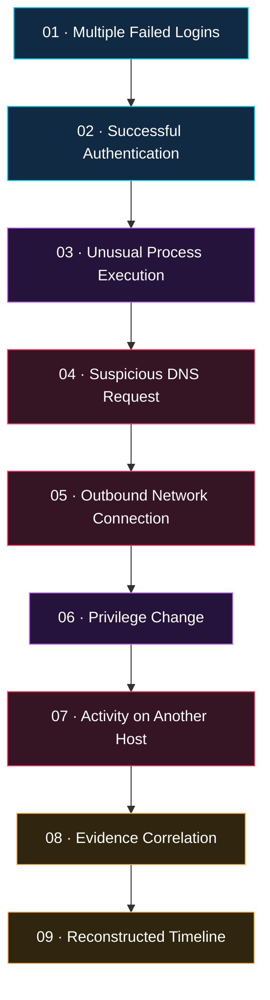

### EVIDENCE-GROUNDED AI · DIGITAL FORENSICS · AUTONOMOUS INVESTIGATION

  
  
  
  

<h3>
  <code>DETECT</code> &nbsp; ◈ &nbsp;
  <code>CORRELATE</code> &nbsp; ◈ &nbsp;
  <code>RECONSTRUCT</code> &nbsp; ◈ &nbsp;
  <code>INVESTIGATE</code>
</h3>

  <strong>Every event leaves a trace. Every hypothesis needs evidence.</strong>

  An intelligent investigation framework that transforms fragmented
  security telemetry into explainable, evidence-linked incident narratives.

 

<a href="#sentinel-x-visual-core">VISUAL CORE</a>
&nbsp; ◆ &nbsp;
<a href="#how-sentinel-x-works">HOW IT WORKS</a>
&nbsp; ◆ &nbsp;
<a href="#research-core">RESEARCH CORE</a>
&nbsp; ◆ &nbsp;
<a href="#project-roadmap">ROADMAP</a>

---

## ◈ SENTINEL-X // VISUAL CORE

**A DIGITAL INVESTIGATION ENGINE**

  
  
  
  

---

⫘⫘⫘⫘⫘⫘⫘⫘⫘⫘⫘⫘⫘⫘⫘⫘⫘⫘⫘⫘⫘⫘⫘⫘⫘⫘⫘⫘⫘⫘⫘⫘⫘⫘⫘⫘
⫘⫘⫘⫘⫘⫘⫘⫘⫘⫘⫘⫘⫘⫘⫘⫘⫘⫘⫘⫘⫘⫘⫘⫘⫘⫘⫘⫘⫘⫘⫘⫘⫘⫘⫘⫘⫘⫘⫘

SENTINEL-X is designed as a complete Master's graduation project combining software engineering, defensive cybersecurity, artificial intelligence, data analysis, graph-based reasoning, and scientific experimentation.

The objective is not simply to create an attractive cybersecurity dashboard. It is to develop a working system that accepts security logs, identifies relationships between events, reconstructs possible incident timelines, links conclusions to supporting evidence, maps observed behaviors to MITRE ATT&CK, and assists a human analyst in investigating suspicious activity.

This document provides the project from A to Z in English, including the academic report, problem statement, objectives, research contribution, system architecture, block diagram, flowcharts, algorithms, data models, implementation code, testing strategy, advantages, limitations, development roadmap, and final-defense preparation.

An important academic distinction: the architecture and code below form a foundation for a research prototype. Any claims about accuracy, performance, completed implementation, or experimental results must be verified by actually implementing and testing the system. We will not invent results or claim that features have been implemented before they exist.

⫘⫘⫘⫘⫘⫘⫘⫘⫘⫘⫘⫘⫘⫘⫘⫘⫘⫘⫘⫘⫘⫘⫘⫘⫘⫘⫘⫘⫘⫘⫘⫘⫘⫘⫘⫘⫘⫘⫘⫘⫘⫘⫘⫘⫘⫘⫘⫘⫘⫘⫘⫘⫘⫘⫘⫘⫘⫘⫘⫘⫘⫘⫘⫘⫘⫘⫘⫘⫘⫘⫘⫘⫘⫘⫘⫘⫘⫘

⫘⫘⫘⫘⫘⫘⫘⫘⫘⫘⫘⫘⫘⫘⫘⫘⫘⫘⫘⫘⫘⫘⫘⫘⫘⫘⫘⫘⫘⫘⫘⫘⫘⫘⫘⫘⫘⫘⫘⫘⫘⫘⫘⫘⫘⫘⫘⫘⫘⫘⫘⫘⫘⫘⫘⫘⫘⫘⫘⫘⫘⫘⫘⫘⫘⫘⫘⫘⫘⫘⫘⫘⫘⫘⫘⫘⫘⫘

⫘⫘⫘⫘⫘⫘⫘⫘⫘⫘⫘⫘⫘⫘⫘⫘⫘⫘⫘⫘⫘⫘⫘⫘⫘⫘⫘⫘⫘⫘⫘⫘⫘⫘⫘⫘⫘⫘⫘⫘⫘⫘⫘⫘⫘⫘⫘⫘⫘⫘⫘⫘⫘⫘⫘⫘⫘⫘⫘⫘⫘⫘⫘⫘⫘⫘⫘⫘⫘⫘⫘⫘⫘⫘⫘⫘⫘⫘

### ◈ ARTIFICIAL INTELLIGENCE &nbsp; ◆ &nbsp; DIGITAL FORENSICS

TEMPORAL RECONSTRUCTION · GRAPH REASONING · INCIDENT RESPONSE

 

  

**Every event leaves a trace. Every hypothesis needs evidence.**

*An AI-assisted framework for transforming fragmented security telemetry into explainable incident investigations.*

### ◈ TABLE OF CONTENTS ◈

| Section | Description |
|:---|:---|
| [`01`](#-01-project-description) | Project Description |
| [`02`](#-02-executive-summary) | Executive Summary |
| [`03`](#-03-project-objectives) | Project Objectives |
| [`04`](#-04-what-makes-sentinel-x-interesting) | Research and Technical Highlights |

---

# 01 // PROJECT DESCRIPTION

UNDERSTANDING THE MISSION · DEFINING THE SYSTEM

> [!IMPORTANT]
> **SENTINEL-X** is an AI-assisted cybersecurity incident investigation platform designed to correlate security events, reconstruct incident timelines, and produce explainable, evidence-linked investigative hypotheses.

## ⌬ The Core Idea

SENTINEL-X processes **heterogeneous security telemetry** and transforms fragmented digital observations into a structured investigation.

Security telemetry includes records generated by:

| 01 · SYSTEMS | 02 · IDENTITY | 03 · NETWORK |
|:---:|:---:|:---:|
| Operating systems | Authentication services | Firewalls |
| Endpoint protection | Identity providers | DNS resolvers |
| Applications | Account activity | Network monitoring |

In a typical organization, these sources generate large volumes of events. Some are harmless, while others may indicate suspicious activity. The challenge is that one incident can span multiple systems and time periods.

## ⌁ A Multi-Stage Incident Scenario

The following sequence illustrates a **hypothetical investigation scenario**, not a claim that an attack has been detected.

Analyzing each event independently may fail to reveal the overall sequence. SENTINEL-X aims to correlate events, construct chronological timelines, identify relationships between users, hosts, processes, and network indicators, and generate hypotheses linked to supporting evidence.

## ◈ The Investigation Principle

| OBSERVED FACT | INFERRED HYPOTHESIS | VERIFIED CONCLUSION |
|:---|:---|:---|
| A recorded event with a traceable source | A possible explanation of several events | A conclusion assessed against available evidence |

The system treats AI as an investigation assistant, not an unquestionable authority. Conclusions must remain traceable to available evidence, uncertainty must be preserved, and consequential decisions must remain under human control.

---

# 02 // EXECUTIVE SUMMARY

THE RESEARCH VISION · THE ENGINEERING MISSION

## SENTINEL-X: An Evidence-Grounded Agentic Framework for Temporal Reconstruction and Investigation of Multi-Stage Cybersecurity Incidents

Modern organizations depend on interconnected digital infrastructure, including endpoints, servers, cloud services, applications, identity providers, and communication networks. These environments generate large quantities of security telemetry that must be analyzed to identify suspicious behavior and investigate potential cyber incidents.

Traditional security monitoring tools can generate alerts using predefined rules, signatures, statistical anomalies, and other detection mechanisms. However, investigating a complex incident often requires an analyst to correlate evidence from multiple sources, reconstruct event sequences, examine relationships between entities, distinguish malicious activity from legitimate behavior, and document the reasoning behind a conclusion.

SENTINEL-X proposes an AI-assisted investigation framework that combines six complementary capabilities:

| Capability | Role in SENTINEL-X |
|:---|:---|
| Event normalization | Converts heterogeneous records into a common representation |
| Temporal correlation | Identifies candidate relationships between events |
| Graph representation | Models relationships between entities and observations |
| Retrieval-augmented generation | Supplies relevant evidence to the AI investigation component |
| Evidence verification | Checks references, contradictions, and unsupported claims |
| Investigation planning | Recommends additional evidence to examine |

Incoming security events are transformed into a common data representation and stored for analysis. A correlation engine identifies candidate relationships using timestamps, entities, event types, and configurable rules. A temporal graph represents relationships among users, hosts, processes, accounts, domains, IP addresses, and observed events.

The AI investigation component can retrieve relevant evidence, formulate hypotheses, identify contradictory observations, and recommend additional evidence that may help resolve uncertainty.

Each hypothesis is designed to include supporting evidence identifiers, contradictory evidence where available, missing evidence, and an explicit investigation status. MITRE ATT&CK can provide a structured reference for mapping observed behavior to known adversary tactics and techniques; a technique match is not, by itself, proof of an attack.

### Experimental Evaluation

The proposed framework will be evaluated using controlled incident scenarios and suitable public datasets. Candidate metrics include:

- Event-correlation precision and recall.
- Timeline reconstruction accuracy.
- MITRE ATT&CK mapping performance.
- Evidence-grounding rate.
- Unsupported-claim rate.
- Processing latency and computational cost.

Baseline systems will be compared with retrieval-enhanced and graph-assisted investigation approaches to determine which components provide measurable benefits.

### Expected Outcome

The expected outcome is a reproducible research prototype and an experimental framework for studying explainable AI-assisted incident investigation. The platform is intended to support qualified security analysts, not replace them. Reliability, operational limitations, and security risks will be assessed through systematic testing.

**Keywords:** Cybersecurity · Incident Response · Digital Forensics · Artificial Intelligence · Large Language Models · Retrieval-Augmented Generation · Event Correlation · Temporal Graphs · MITRE ATT&CK · Explainable AI.

---

# 03 // PROJECT OBJECTIVES

FROM CONCEPT TO IMPLEMENTATION · FROM IMPLEMENTATION TO EVALUATION

### ▸ Primary Objective

Design, implement, and evaluate an evidence-grounded framework for reconstructing multi-stage cybersecurity incidents.

### ▸ Specific Objectives

- [ ] **Data Ingestion:** Collect security events from structured files and supported log sources.
- [ ] **Normalization:** Transform heterogeneous records into a common schema.
- [ ] **Temporal Correlation:** Correlate events using time, identity, host, process, and network information.
- [ ] **Timeline Reconstruction:** Organize potentially related events chronologically.
- [ ] **Graph Modeling:** Represent relevant entities and relationships as a graph.
- [ ] **ATT&CK Integration:** Map observed behavior to relevant MITRE ATT&CK techniques where supported.
- [ ] **RAG Integration:** Retrieve relevant evidence to inform AI-generated analysis.
- [ ] **Evidence-Grounded Hypotheses:** Link investigative claims to supporting and contradictory records.
- [ ] **Missing-Evidence Analysis:** Identify information gaps and recommend next investigative steps.
- [ ] **Report Generation:** Produce structured investigation reports.
- [ ] **Platform Security:** Implement authentication, authorization, input validation, and audit logging.
- [ ] **Scientific Evaluation:** Compare the system with baselines using reproducible experiments.

> [!NOTE]
> The checklist describes the intended development scope. Items should be marked complete only after implementation and testing.

---

# 04 // WHAT MAKES SENTINEL-X INTERESTING?

THE CONVERGENCE OF AI · GRAPH ANALYSIS · DIGITAL FORENSICS

SENTINEL-X brings several technical disciplines together in one research-oriented engineering system.

### 01 — Artificial Intelligence

Uses a large language model to help explain event sequences and formulate investigation hypotheses. Generated explanations must be checked against retrieved records rather than accepted automatically.

### 02 — Graph-Based Analysis

Represents relationships among events, hosts, users, processes, and network entities, making multi-stage activity easier to explore.

### 03 — Temporal Reconstruction

Organizes observations chronologically and identifies plausible relationships across time while preserving uncertainty when event ordering or causality cannot be established.

### 04 — Evidence-Grounded Reasoning

Requires investigative claims to reference available records and distinguishes directly observed facts from inferred explanations.

### 05 — Scientific Evaluation

Tests whether graph-based correlation, retrieval, and evidence verification improve investigation quality compared with simpler baselines.

**SENTINEL-X · INVESTIGATE WITH EVIDENCE. REASON WITH TRANSPARENCY.**

MASTER'S GRADUATION PROJECT · RESEARCH AND ENGINEERING PROTOTYPE

