### EVIDENCE-GROUNDED AI · DIGITAL FORENSICS · AUTONOMOUS INVESTIGATION

  
  
  
  

<h3>
  <code>DETECT</code> &nbsp; ◈ &nbsp;
  <code>CORRELATE</code> &nbsp; ◈ &nbsp;
  <code>RECONSTRUCT</code> &nbsp; ◈ &nbsp;
  <code>INVESTIGATE</code>
</h3>

  <strong>Every event leaves a trace. Every hypothesis needs evidence.</strong>

  An intelligent investigation framework that transforms fragmented
  security telemetry into explainable, evidence-linked incident narratives.

 

<a href="#sentinel-x-visual-core">VISUAL CORE</a>
&nbsp; ◆ &nbsp;
<a href="#how-sentinel-x-works">HOW IT WORKS</a>
&nbsp; ◆ &nbsp;
<a href="#research-core">RESEARCH CORE</a>
&nbsp; ◆ &nbsp;
<a href="#project-roadmap">ROADMAP</a>

---

## ◈ SENTINEL-X // VISUAL CORE

**A DIGITAL INVESTIGATION ENGINE**

  
  
  
  

---

